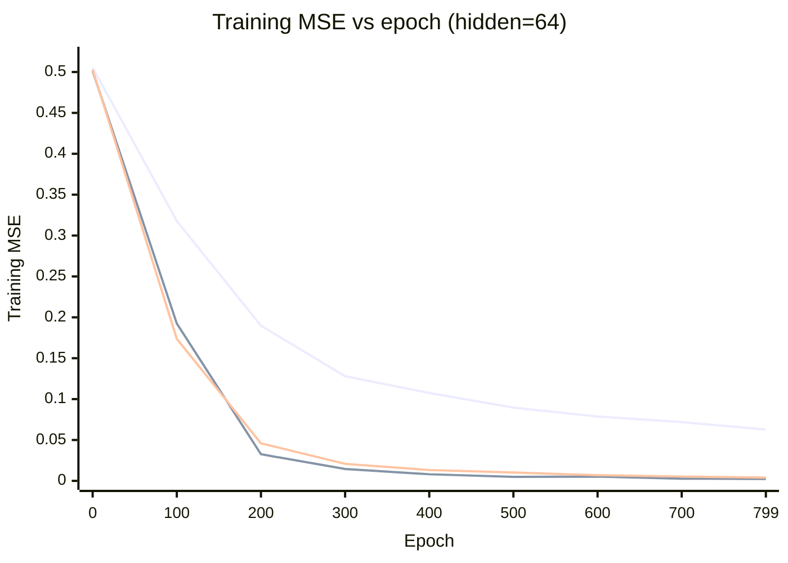
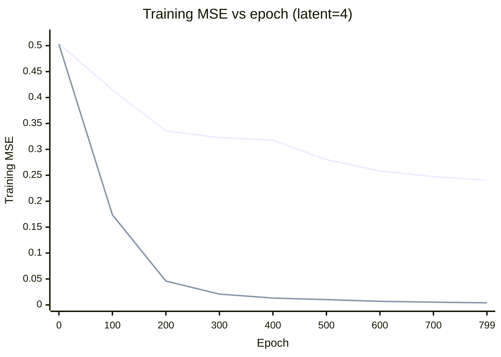
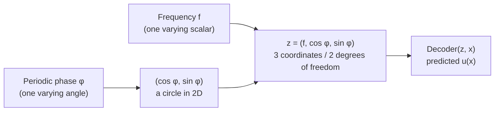

# Day13 — Latent dimension, width, and representation geometry

## Experiment

Function family: `u(x) = sin(2π f x + φ)`, with `f ∈ [0.5, 3]`, `φ ∈ [-π, π]`. There are 512 training functions, 16 fixed input sensors per function, and 24 random query coordinates per function. The network is an encoder–latent–query decoder with Tanh activations. `torch.manual_seed(0)`, Adam `lr=0.001`, 800 epochs; the figures below are **training**, not held-out test, results.

| hidden_dim | latent_dim | train MSE at epoch 799 | sample-0 sensor MSE |
|---:|---:|---:|---:|
| 8 | 4 | 0.240467 | 0.410378 |
| 64 | 2 | 0.062785 | 0.056688 |
| 64 | 3 | **0.002244** | **0.003372** |
| 64 | 4 | 0.004023 | 0.010401 |

### Recorded convergence: hidden_dim=64, varying latent_dim

Lines in order: **latent=2**, **latent=3**, **latent=4** (GitHub Mermaid xychart lacks a built-in line legend in some renderers). All points are the reported epoch values, not interpolated experiments.

Underlying epoch measurements

| Epoch | latent 2 | latent 3 | latent 4 |
|---:|---:|---:|---:|
| 0 | 0.505432 | 0.501278 | 0.502771 |
| 100 | 0.317815 | 0.192430 | 0.173781 |
| 200 | 0.189776 | 0.032567 | 0.045945 |
| 300 | 0.127953 | 0.014496 | 0.020830 |
| 400 | 0.107487 | 0.008093 | 0.013263 |
| 500 | 0.089610 | 0.004956 | 0.010175 |
| 600 | 0.078805 | 0.005163 | 0.006913 |
| 700 | 0.071797 | 0.002713 | 0.005339 |
| 799 | 0.062785 | 0.002244 | 0.004023 |

### Recorded convergence: hidden_dim=8 vs 64, latent_dim=4

Lines in order: **hidden=8** and **hidden=64**.

## Quantified comparisons

> **At latent=4, increasing hidden width from 8 to 64:** training MSE decreased from 0.240467 to 0.004023 — **98.33% lower** (about **59.8×** smaller); sample-0 sensor MSE decreased from 0.410378 to 0.010401 — **97.47% lower** (about **39.5×** smaller).

> **At hidden=64, changing latent from 2 to 3:** training MSE decreased from 0.062785 to 0.002244 — **96.43% lower** (about **28.0×** smaller). Latent=3 also reached a **44.22% lower** training MSE than latent=4 (0.002244 vs 0.004023) in these single runs.

These percentages compare reported final errors, **not** relative improvements in generalization.

## Geometric intuition (illustration, not a measured latent plot)

The functions vary with two parameters `(f, φ)`. The common `sin` rule need not be a separate latent variable: the decoder weights can learn it. But **intrinsic dimension** and the dimension of a *convenient continuous Euclidean representation* can differ.

One possible three-coordinate embedding is `z ≈ (f, cos φ, sin φ)`, where `cos²φ + sin²φ = 1`. The phase pair traces a circle; adding frequency produces a cylinder-like two-dimensional surface embedded in three-dimensional space:

**Conceptual geometric sketch:** `S¹ × [0.5,3]` is topologically a cylindrical surface, **not** evidence that the trained latent points actually form a cylinder. To test this conjecture, collect learned `z` for known `(f,φ)`, visualize `z` in 3D, and examine correspondence to `f`, `sinφ`, and `cosφ`.

## Interpretation and limitations

- Increasing hidden width changes decoder/encoder capacity **and optimization**, not the latent bottleneck alone.
- Latent 3 greatly outperformed latent 2 in these 800-epoch experiments; latent 2 was still improving at epoch 799. This **does not establish** that latent 3 is a mathematical minimum.
- Latent 4 is not inherently weaker than latent 3. Changing dimensions changes parameter shapes, initializations, and optimization paths despite a fixed seed.
- The reported sensor MSE is for one training function at 16 input sensor positions. It is different from dataset-wide training MSE and is not a held-out test.
- The original `lr=0.1` Adam run trained poorly. Also, the initial loss print was inflated because the sample-weighted epoch sum was divided by batches instead of the number of samples.

**Next diagnostic:** test unseen frequencies/phases with new query points, and visualize the learned 3D latent cloud.
